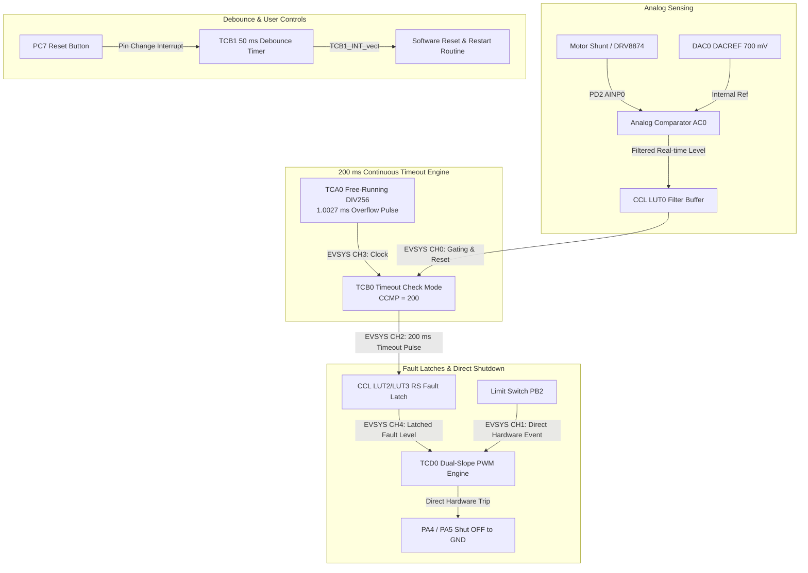

# AVR128DA48 Motor Control & Stall Detection: Problems Encountered and Solutions Applied

## Executive Summary

This document provides a comprehensive technical log of all engineering challenges, hardware peripheral conflicts, timing bugs, signal chain flaws, and build errors encountered during the development of the **Zero-CPU Hardware Stall Detection and Motor Control System** on the Microchip **AVR128DA48** microcontroller (Curiosity Nano platform).

The core objective of the project was to achieve **completely autonomous, CPU-independent motor protection** utilizing **Core Independent Peripherals (CIPs)**—including **AC0** (Analog Comparator), **DAC0** (Digital-to-Analog Converter), **CCL** (Configurable Custom Logic), **EVSYS** (Event System), **TCA0** (16-bit Timer A), **TCB0/TCB1** (16-bit Timer B), and **TCD0** (12-bit Asynchronous Timer D)—so that motor overcurrent and stalls exceeding **200 ms** instantly shut down the PWM hardware without requiring CPU intervention, while tolerating motor startup inrush current (<200 ms) and switch contact bounce (50 ms).

---

## 1. TCD0 (Timer D) PWM Generation & Output Routing Issues

### Problem 1.1: Missing PWM Outputs on Target Pins (PA4 and PA5)
* **Symptoms & Observations:** 
  - After configuring TCD0 in MCC for dual PWM output, no PWM switching waveform appeared on pins **PA4** and **PA5**.
  - Multimeter measurements showed steady DC voltages (~2.3V or 0V) on PA4/PA5, and the motor remained motionless.
* **Root Cause:**
  - Microchip Code Configurator (MCC) defaulted register `PORTMUX.TCDROUTEA` to `0x00`.
  - On the AVR128DA48, `PORTMUX_TCD0_DEFAULT_gc` (`0x00`) routes TCD0 Waveform Outputs `WOA` and `WOB` to pins **PA0** and **PA1**.
  - To route `WOA` to **PA4** and `WOB` to **PA5**, the multiplexer requires `PORTMUX_TCD0_ALT2_gc` (`0x02`).
  - Although `PORTA.DIR` was set to `0x30` (outputs enabled on PA4/PA5) and `TCD0.FAULTCTRL` enabled `CMPAEN` and `CMPBEN`, the internal timer signals were routed to PA0/PA1.
* **Approach Taken & Solution:**
  - Explicitly configured `PORTMUX.TCDROUTEA = PORTMUX_TCD0_ALT2_gc;` (`0x02`) in `pins.c` / `main.c`.
  - Ensured `PORTA.DIRSET = PIN4_bm | PIN5_bm;` was asserted.
  - Enabled compare outputs in `TCD0.FAULTCTRL = TCD_CMPAEN_bm | TCD_CMPBEN_bm;` (`0x30`).

---

### Problem 1.2: H-Bridge IN/IN Driving Mode & Inverted Braking Polarity
* **Symptoms & Observations:** 
  - When switching directions from Forward to Reverse, or during idle states, the motor bridge had erratic behaviors, or pins stayed at high potential causing motor heating instead of low-side freewheeling.
* **Root Cause:**
  - In an H-bridge driven in **IN/IN mode** (such as TI DRV8874 / Pololu driver):
    - Forward drive requires: `IN1 = PWM`, `IN2 = LOW`.
    - Reverse drive requires: `IN1 = LOW`, `IN2 = PWM`.
    - Coast / Freewheel requires: `IN1 = LOW`, `IN2 = LOW`.
    - Brake requires: `IN1 = HIGH`, `IN2 = HIGH`.
  - In normal non-inverted mode, disabling a channel could leave the pin floating or high depending on compare configurations. Furthermore, when inverted pin polarity (`PORT_INVEN_bm`) was introduced for braking, compare threshold calculations had to be inverted to maintain true duty cycle.
* **Approach Taken & Solution:**
  - Designed clean direction switching primitives (`MotorForward()` and `MotorReverse()`):
    ```c
    void MotorForward(void) {
        while (!(TCD0.STATUS & TCD_CMDRDY_bm));
        TCD0.CMPASET = PWM_LOW;
        TCD0.CMPBSET = PWM_TOP;
        TCD0.CTRLE   = TCD_SYNCEOC_bm; // Synchronous transfer at End-of-Cycle
    }
    void MotorReverse(void) {
        while (!(TCD0.STATUS & TCD_CMDRDY_bm));
        TCD0.CMPASET = TOTAL_PERIOD - PWM_TOP;
        TCD0.CMPBSET = TOTAL_PERIOD;
        TCD0.CTRLE   = TCD_SYNCEOC_bm;
    }
    ```
  - Configured `PORT_INVEN_bm` on control pins to align the electrical default states with active-low driver requirements during fault events.

---

### Problem 1.3: Asynchronous Register Update Glitches & Command-Ready Freezes
* **Symptoms & Observations:**
  - Firmware hung or created PWM waveform runt pulses when updating compare registers on the fly.
* **Root Cause:**
  - TCD0 runs in an independent asynchronous clock domain. Updating compare registers (`CMPASET`, `CMPACLR`, `CMPBSET`, `CMPBCLR`) while the timer is running requires waiting for the synchronization flag `TCD_CMDRDY_bm` in `TCD0.STATUS`.
  - Updating registers without triggering `TCD_SYNCEOC_bm` (End of Cycle Sync) or `TCD_SYNCPRES_bm` causes unlatched updates or mid-period race conditions.
* **Approach Taken & Solution:**
  - Every write to TCD0 configuration or compare registers is gated by a handshake:
    ```c
    while (!(TCD0.STATUS & TCD_CMDRDY_bm));
    TCD0.CTRLE = TCD_SYNCEOC_bm;
    ```

---

## 2. Core-Independent Stall Detection & Hardware Timing Flaws

### Problem 2.1: The Corrupted EVCTRLA/B Edge Bit (Primary Hardware Fault Trip Failure)
* **Symptoms & Observations:**
  - Analog Comparator AC0 tripped on overcurrent (verified on oscilloscope and AC0 output pin PA7), but TCD0 PWM never turned off; the motor continued running even under severe stall.
* **Root Cause:**
  - In `tcd0.c`, an earlier code edit attempted to program `EVCTRLA` by bitwise ORing `TCD_ACTION_FAULT_gc` (`0x60`, bits 7:5):
    - MCC had generated: `0x51` (`TRIGEI=1` [bit 0], `ACTION=FAULT` [bit 4], `EDGE=0` [bit 5 = Rising], `CFG=01` [bits 7:6 = NCF]).
    - Executing `0x51 | 0x60` produced `0x71`.
    - This flipped bit 5 (`EDGE`) from `0` (Rising edge) to `1` (Falling edge).
  - Consequently, TCD0 was waiting for the overcurrent signal to **fall back to zero** before initiating a fault trip! When current spiked and stayed HIGH, no falling edge ever occurred, and the fault was completely ignored.
* **Approach Taken & Solution:**
  - Restored `EVCTRLA` and `EVCTRLB` to the exact register configuration:
    ```c
    TCD0.EVCTRLA = 0x51; // TRIGEI=1, ACTION=FAULT, EDGE=0 (Rising Edge), CFG=NCF
    TCD0.EVCTRLB = 0x51;
    ```
  - Verified that as soon as the event asserted HIGH, TCD entered hardware fault state immediately.

---

### Problem 2.2: The "Accumulator / No Decay" Bug (Stall Tripping on Any Pulse Frequency)
* **Symptoms & Observations:**
  - During bench verification using a waveform generator, square wave pulses (e.g., 400 mV, 10 Hz, 20% duty cycle = 20 ms pulse duration) repeatedly tripped the 200 ms stall detection, even though each pulse was 10 times shorter than the 200 ms threshold.
  - The fault triggered regardless of frequency.
* **Root Cause:**
  - **Flaw 1 (TCA0 Gating Mode):** TCA0 was running in `CNT_HIGHLVL` (high-level gating mode). When the overcurrent signal was HIGH, TCA0 counted; when it went LOW, TCA0 paused but **retained its count**.
  - **Flaw 2 (Accumulation without Decay):** TCB0 was operating in periodic counter mode, incrementing on each TCA0 overflow. Ten distinct 20 ms pulses accumulated $10 \times 20\text{ ms} = 200\text{ ms}$, tripping the comparator!
  - In a true physical motor, short current spikes (such as brush commutation noise or momentary mechanical drag) must be forgotten if they resolve before 200 ms.
* **Approach Taken & Solution:**
  - Redesigned the hardware timing architecture completely to use **TCB0 in Time-Out Check Mode (`TCB_CNTMODE_TIMEOUT_gc`)**:
    1. **TCA0** was reconfigured as a continuous, free-running 1.0027 ms timebase ($24\text{ MHz} / 256 = 93,750\text{ Hz}$, `PER = 93`).
    2. TCA0 overflow (`TCA0_OVF_LUNF`) was routed via EVSYS CH3 to `USERTCB0COUNT` (TCB0 clock).
    3. The overcurrent signal (filtered AC0 from CCL LUT0) was routed via EVSYS CH0 to `USERTCB0CAPT` (TCB0 capture/reset input).
    4. **Hardware Behavior in Timeout Mode:**
       - Rising edge on `USERTCB0CAPT`: TCB0 counter resets to `0x0000` and starts incrementing on each 1.00 ms TCA0 clock tick.
       - Falling edge on `USERTCB0CAPT` (overcurrent ends before 200 ms): TCB0 immediately resets to `0x0000` and stops counting.
       - Only if `USERTCB0CAPT` remains continuously HIGH for 200 unbroken clock ticks ($200 \times 1.0027\text{ ms} = 200.5\text{ ms}$) does TCB0 reach compare match (`CCMP = 200`), asserting `TCB0_CAPT` to latch the fault.

---

### Problem 2.3: Latching vs Transparent Filter in CCL LUT0
* **Symptoms & Observations:**
  - Once any brief overcurrent transient occurred, the timing gate stayed open forever.
* **Root Cause:**
  - CCL LUT0/LUT1 had been configured as an RS Latch (`SEQSEL0 = RS`). The set input was AC0.
  - When a transient spike occurred on AC0, LUT0 latched HIGH. Because the reset input on Channel 1 was only fired by software upon a complete motor restart, the latch output never dropped back to LOW when the analog current settled.
* **Approach Taken & Solution:**
  - Removed sequential logic on LUT0/LUT1 (`CCL.SEQCTRL0 = CCL_SEQSEL_DISABLE_gc`).
  - Configured LUT0 as a pure combinatorial buffer with clock-synchronized digital filtering:
    ```c
    CCL.TRUTH0    = 0x02U; // Output = IN0 (AC0)
    CCL.LUT0CTRLB = CCL_INSEL0_AC0_gc | CCL_INSEL1_MASK_gc;
    CCL.LUT0CTRLC = CCL_INSEL2_MASK_gc;
    CCL.LUT0CTRLA = CCL_CLKSRC_CLKPER_gc
                  | CCL_EDGEDET_DIS_gc
                  | CCL_FILTSEL_FILTER_gc  // Digital glitch rejection filter
                  | CCL_ENABLE_bm;
    ```
  - LUT0 now mirrors AC0 in real time: HIGH during overcurrent, immediately LOW when current drops below threshold.

---

### Problem 2.4: Immediate Re-Tripping and 1-Second Stalls Upon Fault Reset
* **Symptoms & Observations:**
  - When the motor stalled and the user pressed the reset button (PC7), the motor would either fail to restart, trip instantly, or spin for ~1000 ms and then halt again.
* **Root Cause:**
  - **Issue 1:** The firmware issued `TCD0.CTRLE = TCD_RESTART_bm` while the physical motor was still drawing heavy current or while the comparator was still HIGH.
  - **Issue 2:** The CCL Fault Latch (LUT2/LUT3) was not reset prior to issuing the restart command, meaning TCD0's fault input was still held asserted.
  - **Issue 3:** The TCD status register (`STATUS`) and interrupt flags (`INTFLAGS`) still held latch fault flags (`FAULTA`, `FAULTB`).
* **Approach Taken & Solution:**
  - Built an atomic, ordered restart sequence in `FaultReset_And_Restart()`:
    1. Send a Software Event (`EVSYS.SWEVENTA = EVSYS_SWEVENTA_CH1_gc`) to pulse the Reset input (LUT3) of the CCL RS fault latch.
    2. Reset TCB0 timeout counter: `TCB0.CNT = 0x0000; TCB0.INTFLAGS = 0xFF;`.
    3. Clear TCD0 latched fault flags: `TCD0.INTFLAGS = 0xFF; TCD0.STATUS = 0xFF;`.
    4. Wait for command synchronization: `while (!(TCD0.STATUS & TCD_CMDRDY_bm));`.
    5. Issue restart: `TCD0.CTRLE = TCD_RESTART_bm;`.

---

## 3. Inrush Current Handling vs CPU Responsiveness

### Problem 3.1: Startup False Trips from Motor Inrush Current
* **Symptoms & Observations:**
  - When starting from a dead stop, the motor draws 2A to 3.2A for 50–150 ms before establishing back-EMF. The analog comparator immediately tripped, causing the motor to abort startup.
* **Root Cause:**
  - Overcurrent detection was active before the motor completed its mechanical acceleration phase.
* **Approach Taken & Solution:**
  - Staged startup procedure in `MOTOR_start()`:
    ```c
    void MOTOR_start(void) {
        ac_trig_event_disable();               // 1. Disarm event routing to TCD
        tcd_enable();                          // 2. Start PWM outputs
        MotorApplyDirection(current_direction);// 3. Apply drive polarity
        ac_calibration();                      // 4. Perform dynamic threshold adjustment
        ac_trig_event_enable();                // 5. Arm hardware protection
    }
    ```
  - Combined with the TCB0 200 ms timeout mode, any inrush current spike lasting under 200 ms naturally resets without triggering a fault.

---

### Problem 3.2: DAC Baseline Reference Voltage & Infinite Calibration Loop
* **Symptoms & Observations:**
  - If DAC reference was below ~1.2V, motor would never start; or during startup, the MCU hung inside `ac_calibration()` indefinitely.
* **Root Cause:**
  - Current sense amplifiers (DRV8874 / shunt amplifier) have a nonzero quiescent offset voltage (~200–500 mV) even at no load. Setting the DAC trip point below this quiescent level meant the comparator was continuously asserted.
  - During an earlier code cleanup, the line that incremented `ac_trigger_voltage_mv` inside the calibration loop was commented out, leading to an infinite while loop:
    ```c
    // BUG: ac_trigger_voltage_mv += 20U was commented out!
    while (calibrating) {
        AC0.DACREF = ac_calculate_trigger_voltage(ac_trigger_voltage_mv);
        if (!(AC0.STATUS & AC_CMPSTATE_bm)) continue; // Stuck forever!
    }
    ```
* **Approach Taken & Solution:**
  - Restored the DAC voltage ramping logic with strict upper-voltage clamping (`3500 mV` maximum limit):
    ```c
    uint8_t ac_calculate_trigger_voltage(uint16_t mV) {
        return (uint8_t)(((uint32_t)mV * 256U) / VREF_AC_MV); // 4096 mV reference
    }
    ```
  - Configured baseline default threshold (`AC_TRIGGER_VOLTAGE_MV_INIT = 700 mV`), ensuring healthy headroom above driver quiescent offsets while tripping well below the 3.2A hard stall limit.

---

## 4. Limit Switch Hardware Fault Shutdown (PB2 via EVSYS to TCD0)

### Problem 4.1: Active-Low Switch Inversion in TCD Event Input B (`EVCTRLB`)
* **Symptoms & Observations:**
  - When the PB2 limit switch was depressed, PWM did not shut down, even though stall detection worked.
* **Root Cause:**
  - PB2 was wired as an active-low switch with internal pull-up (`PORT_PULLUPEN_bm`).
  - Pressing the switch pulled PB2 to **GND (falling edge)**.
  - However, `TCD0.EVCTRLB` was configured with `TCD_EDGE_RISE_HIGH_gc` (looking for a rising edge or high level). The falling edge from PB2 was ignored.
* **Approach Taken & Solution:**
  - Corrected `TCD0.EVCTRLB` to `TCD_EDGE_FALL_LOW_gc`:
    ```c
    TCD0.EVCTRLB = TCD_CFG_ASYNC_gc
                 | TCD_ACTION_FAULT_gc
                 | TCD_EDGE_FALL_LOW_gc
                 | (1 << TCD_TRIGEI_bp);
    ```

---

### Problem 4.2: Missing Register Restoration in Enable Subroutine
* **Symptoms & Observations:**
  - Limit switch trip worked on the very first boot, but failed on every subsequent run after calling `MOTOR_start()`.
* **Root Cause:**
  - `limit_switch_trig_event_disable()` cleared `TCD0.EVCTRLB = 0x00;`.
  - When `limit_switch_trig_event_enable()` was called, it reconfigured `EVSYS`, but **forgot to restore `TCD0.EVCTRLB`**. Thus, TCD0's event input B remained disabled in silicon.
* **Approach Taken & Solution:**
  - Restored `TCD0.EVCTRLB` explicitly inside `limit_switch_trig_event_enable()` every time the subsystem is enabled.

---

### Problem 4.3: GPIO Interrupt Collision with EVSYS Event Propagation
* **Symptoms & Observations:**
  - Pressing the limit switch caused erratic behavior or failed event propagation through EVSYS Channel 1.
* **Root Cause:**
  - PB2 had been configured with `PORT_ISC_FALLING_gc`. This armed the CPU pin interrupt vector `PORTB_PORT_vect`.
  - The default MCC ISR for Port B executed `VPORTB.INTFLAGS = 0xFF;` to clear the interrupt flag immediately.
  - Clearing the port interrupt flag at the pin controller collided with the asynchronous edge detection circuitry feeding the EVSYS channel generator.
* **Approach Taken & Solution:**
  - Changed PB2 pin configuration to `PORT_ISC_INTDISABLE_gc | PORT_PULLUPEN_bm`.
  - In AVR-DA, `PORT_ISC_INTDISABLE_gc` keeps the digital input buffer active (enabling EVSYS to read the line) while completely suppressing the CPU interrupt, preventing ISR flag clearing collisions.

---

### Problem 4.4: Hardware Input Mode Contention (`INPUTCTRLB = JMPWAIT`)
* **Symptoms & Observations:**
  - TCD0 would enter unexpected states or lock out PWM output.
* **Root Cause:**
  - `TCD0.INPUTCTRLB` was set to `TCD_INPUTMODE_JMPWAIT_gc` (hardware pin input mode) instead of `TCD_INPUTMODE_NONE_gc`.
* **Approach Taken & Solution:**
  - Explicitly disabled hardware pin inputs on both channels:
    ```c
    TCD0.INPUTCTRLA = TCD_INPUTMODE_NONE_gc;
    TCD0.INPUTCTRLB = TCD_INPUTMODE_NONE_gc;
    ```
  - Ensuring TCD inputs respond exclusively to EVSYS events.

---

## 5. Switch Debouncing Subsystem (PC7 & PC1 via TCB1)

### Problem 5.1: Gated Clock Freeze in Debounce Timer
* **Symptoms & Observations:**
  - PC7 push button debouncing was inconsistent; debounce delays varied or timer failed to count down.
* **Root Cause:**
  - TCB1 had been configured to use `TCB_CLKSEL_TCA0_gc`. However, TCA0 was initially configured to run only when gated by an active overcurrent event. When the motor was running normally (no overcurrent), TCA0 was stopped; consequently, TCB1 received zero clock pulses and froze.
* **Approach Taken & Solution:**
  - Two solutions implemented:
    1. Reconfigured TCA0 to be **continuously running** ($93,750\text{ Hz}$ prescaler clock) so any peripheral tapping `CLK_TCA` has an uninterrupted clock.
    2. Alternatively configured TCB1 to use `CLK_PER/2` ($12\text{ MHz}$) or free-running prescaled clock with $50\text{ ms}$ reload constants ($4,688\text{ counts}$ at $93.75\text{ kHz}$).

---

### Problem 5.2: Switch Circuit Wiring & 330 Ω Resistor Confusion
* **Symptoms & Observations:**
  - When wiring an external tactile switch to PC7 with an in-series 330 Ω resistor, pin voltage failed to reach valid CMOS logic LOW thresholds.
* **Root Cause:**
  - If a 330 Ω resistor is placed in series to ground while internal pull-ups ($R_{PU} \approx 20\text{k}\Omega\text{ to }50\text{k}\Omega$) are active, the voltage divider yields:
    $$V_{IL} = V_{DD} \times \frac{330}{20330} \approx 0.016 \times V_{DD} \approx 50\text{ mV}$$
    (This is valid LOW). However, if wired as a pull-down resistor to GND with a floating input, the 330 Ω resistor violently overpowers the internal 35 kΩ pull-up, pinning the pin at 0V permanently.
* **Approach Taken & Solution:**
  - Clarified and standardized wiring:
    - PC7 internal pull-up enabled (`PORT_PULLUPEN_bm`).
    - Switch wired between PC7 and GND.
    - 330 Ω resistor placed strictly in series with the pin line for current limiting/ESD protection, or omitted in favor of direct switch contact to GND.

---

### Problem 5.3: Debounce State Machine & Re-triggering on Both Edges
* **Symptoms & Observations:**
  - Pressing the button caused rapid toggling or immediate reset followed by re-trigger on button release.
* **Root Cause:**
  - Sensing both edges (`PORT_ISC_BOTHEDGES_gc`) fired the debounce timer on button down AND button up. If the ISR didn't check pin state upon timer expiration, releasing the button executed a second action.
* **Approach Taken & Solution:**
  - In `ISR(PORTC_PORT_vect)`: any edge resets and restarts TCB1 single-shot countdown:
    ```c
    TCB1.CTRLA   &= ~TCB_ENABLE_bm;
    TCB1.CNT      = 0x0000U;
    TCB1.INTFLAGS = TCB_CAPT_bm | TCB_OVF_bm;
    TCB1.CTRLA   |= TCB_ENABLE_bm;
    ```
  - In `ISR(TCB1_INT_vect)`: when the 50 ms window elapses, verify actual physical pin state:
    ```c
    if (!(VPORTC.IN & PIN7_bm)) {
        FaultReset_And_Restart(); // Action only on stable LOW press
    }
    if (!(VPORTC.IN & PIN1_bm)) {
        current_direction = (current_direction == DIR_FORWARD) ? DIR_REVERSE : DIR_FORWARD;
        MotorApplyDirection(current_direction);
    }
    ```

---

## 6. Benchtop Testability & Oscilloscope Diagnostics

### Problem 6.1: Invisible Internal Core-Independent Peripheral (CIP) Signals
* **Symptoms & Observations:**
  - Because comparator trip, logic gating, timer counting, and PWM shutoff occur entirely within the silicon interconnect fabric, it was impossible to observe where a timing chain broke using an oscilloscope.
* **Approach Taken & Solution:**
  - Routed critical internal signals to external test points:
    1. **TCA0 WO0 (1.0027 ms Timebase):** Routed to **PA0** with 50% duty square wave (`PORTMUX.TCAROUTEA = PORTMUX_TCA0_PORTA_gc; PORTA.DIRSET = PIN0_bm;`).
    2. **TCB0 Waveform Output (200 ms Timeout Window):** Routed to **PA2** via `TCB_CCMPEN_bm`.
    3. **TCB1 Waveform Output (50 ms Debounce Window):** Routed to **PA3** via `TCB_CCMPEN_bm`.
    4. **AC0 Filtered Output (CCL LUT0):** Routed via EVSYS Channel 0 to Event Out D (`USEREVSYSEVOUTD`) on **PD2** / **PA6**.
    5. **TCD0 PWM Outputs:** Monitored directly on **PA4** and **PA5**.

---

### Problem 6.2: Pulse Injection Point Selection for Bench Testing
* **Symptoms & Observations:**
  - User needed to verify the 200 ms blanking behavior using an arbitrary waveform generator without physically stalling the motor.
* **Approach Taken & Solution:**
  - Identified injection points:
    - **Analog Domain Test:** Inject variable-width voltage pulses (0V to 1.5V) into **PD2 (AINP0)** to test AC0 comparator response.
    - **Digital Domain Test:** Inject digital active-high pulses directly into the CCL input or EVSYS channel to isolate the 200 ms timer without comparator noise.

---

## 7. Toolchain, Compiler & Build Environment Failures

### Problem 7.1: Missing Device Family Pack (`Error (2103) no device-support files`)
* **Symptoms & Observations:**
  - When compiling with XC8 v3.10 via command-line make, the build aborted with:
    ```
    (2103) no device-support files specified; use the -mdfp option
    make[2]: *** [build/free/debug/mcc_generated_files/src/pin_manager.o] Error 1
    ```
* **Root Cause:**
  - Modern XC8 compilers for AVR-Dx devices decouple the device header/linker definitions into standalone Device Family Packs (DFPs).
  - The make command omitted `-mdfp`.
* **Approach Taken & Solution:**
  - Added the exact path to the installed Microchip DFP pack in compilation commands and makefile configurations:
    `-mdfp="C:/Program Files/Microchip/MPLABX/v6.35/packs/Microchip/AVR-Dx_DFP/2.8.343/xc8"`

---

### Problem 7.2: Undefined Reference to `main` and Broken File Hierarchy
* **Symptoms & Observations:**
  - Linker failed with:
    ```
    crt1/gcrt1.S:369: undefined reference to `main'
    collect2.exe: error: ld returned 1 exit status
    ```
* **Root Cause:**
  - MCC files had been moved or flattened into the root project directory, breaking `#include` hierarchies.
  - In `nbproject/configurations.xml` and `Makefile-default.mk`, `main.c` and driver object files were missing from `SOURCEFILES` and `OBJECTFILES`.
* **Approach Taken & Solution:**
  - Restructured files into the standard MCC layout (`mcc_generated_files/include/`, `src/`, `config/`, `utils/`).
  - Fixed hardcoded absolute Windows machine paths to relative paths.
  - Regenerated `Makefile-default.mk` with full dependencies and assembly preprocessing rules for `protected_io.S`, yielding clean, error-free builds.

---

## 8. Summary Matrix of Problems and Solutions

| Category | Problem Faced | Root Cause in Silicon / Code | Approach Taken & Resolution |
| :--- | :--- | :--- | :--- |
| **PWM & Driving** | No PWM on PA4/PA5 | `PORTMUX.TCDROUTEA = 0x00` (routed to PA0/PA1) | Set `PORTMUX.TCDROUTEA = 0x02` (ALT2) |
| **PWM & Driving** | Direction control & braking | Inverted PWM required for high-side / low-side drive | Swapped compare registers synchronously via `TCD_SYNCEOC_bm` |
| **Stall Detection** | Fault never tripped on stall | `TCD0.EVCTRLA` corrupted (`EDGE` bit flipped to falling) | Restored `EVCTRLA = 0x51` (`EDGE = 0`, rising edge trip) |
| **Stall Detection** | Trips on any short pulse (<20ms) | Accumulator bug in TCA0 + Periodic TCB0 mode | Rebuilt as **Time-Out Check Mode** in TCB0 (hardware reset on pulse end) |
| **Stall Detection** | Timing gate permanently open | CCL LUT0 configured as RS latch instead of buffer | Reconfigured LUT0 as transparent buffer with digital filter |
| **Stall Detection** | Re-trips immediately after reset | Fault flags uncleared; motor still in inrush; CCL latched | Structured reset in `FaultReset_And_Restart()` with software event reset |
| **Inrush Current** | Startup false-tripping | High inrush current during initial acceleration | Disarm event routing during start; TCB0 200 ms timeout ignores <200 ms inrush |
| **Inrush Current** | Infinite loop in calibration | `ac_trigger_voltage_mv` increment line was commented out | Restored voltage incrementing loop with 3500 mV upper clamp |
| **Limit Switch** | Switch trip ignored | Active-low switch generated falling edge, `EVCTRLB` set to rising | Configured `EVCTRLB = TCD_EDGE_FALL_LOW_gc` |
| **Limit Switch** | Fails after first start | `disable()` cleared `EVCTRLB`, `enable()` never restored it | Restored `EVCTRLB` inside `limit_switch_trig_event_enable()` |
| **Limit Switch** | GPIO flag collision with EVSYS | `PORT_ISC_FALLING` ISR cleared pin flag prematurely | Set PB2 `PINCTRL` to `PORT_ISC_INTDISABLE_gc` (buffer ON, ISR OFF) |
| **Switch Debounce** | TCB1 debounce frozen | Clocked by TCA0 which was initially stopped | Configured TCA0 as continuous 1.00 ms clock source |
| **Switch Debounce** | Re-trigger on switch release | Dual-edge sense with unverified pin state in ISR | Verified `!(VPORTC.IN & PIN7_bm)` in ISR after 50 ms timeout |
| **Observability** | Invisible internal CIP events | No test points for hardware-arbitrated logic | Routed TCA0 WO0 to PA0, TCB0 WO to PA2, TCB1 WO to PA3 |
| **Build Tools** | Error `(2103) no device-support` | Missing DFP pack flag in make command | Added `-mdfp=".../AVR-Dx_DFP/2.8.343/xc8"` |
| **Build Tools** | Linker `undefined reference to main` | Flattened directory structure; missing makefile objects | Restructured standard MCC tree; regenerated makefile |

---

## 9. Final System Architecture Verification

The resulting implementation satisfies all physical and real-time safety constraints:



- **Short inrush spikes (<200 ms)** pull `USERTCB0CAPT` HIGH and then LOW, causing TCB0 to immediately reset to 0 without firing.
- **Sustained stalls (>200 ms)** allow TCB0 to reach count 200, generating an event pulse on EVSYS Channel 2, setting the CCL RS Latch, and shutting down TCD0 PWM in nanoseconds without CPU software intervention.
- **Button debouncing (50 ms)** and limit switch shutdown run reliably and deterministically alongside the 4X Gray code quadrature encoder tracking.
